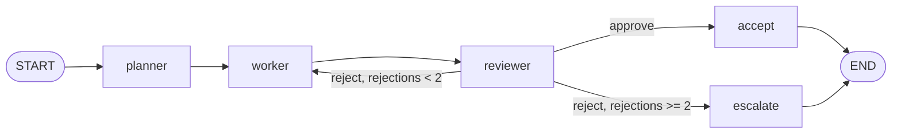

# Multi-Agent Workflow with LangGraph

A planner, a worker and a reviewer modelled as a graph with explicit shared state.
The reviewer can send work back to the worker - that rework edge is the interesting part.

## Graph


## State schema (`graph.py: State`)
| Field | Purpose |
|---|---|
| `task` | Original request |
| `plan` | Planner output |
| `draft` | Latest worker output (overwritten each pass) |
| `feedback` | Reviewer's notes, fed back into the worker prompt |
| `verdict` | `approve` / `reject` |
| `rejections` | Counter that drives the conditional edge |
| `status` | Final outcome: `approved` or `escalated` |
| `log` | Append-only trace (uses a reducer, `operator.add`) |

## Checklist
- **3+ nodes with clear state schema:** 5 nodes, typed `State` above.
- **Conditional edge:** `route()` after the reviewer is a three-way decision.
- **Diagram:** above (also `build_graph(llm).get_graph().draw_mermaid()`).
- **Reviewer rejects twice:** the second rejection routes to `escalate`, which stops the loop, returns the *last draft* and sets `status="escalated"` so a human knows it never passed review. Without this exit the graph would loop forever (or hit LangGraph's recursion limit). An unparseable review is treated as a reject, not a pass.

## Run
```bash
pip install -r requirements.txt
export ANTHROPIC_API_KEY=...
python graph.py "Write a 150-word explainer on what an MCP server is."
pytest   # fake-LLM tests for approve / rework / escalate paths
```

## Failure mode note
See `FAILURE_MODE.md` - replace the placeholder with what you actually observed.

## Before you publish
- Run it on a few tasks and write your real finding in `FAILURE_MODE.md`.
- Replace `Your Name` in `LICENSE`.
- Copy `.env.example` to `.env` locally; `.env` is git-ignored, so your key never gets pushed.
